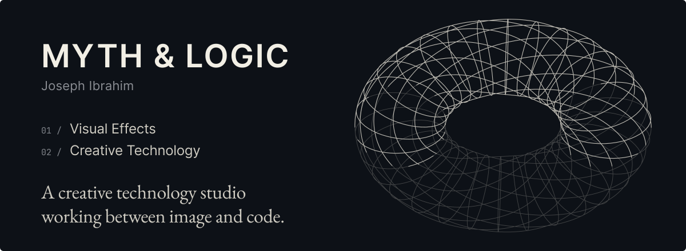

<a href="https://mythandlogic.studio"><picture>
  <source media="(max-width: 600px)" srcset="./assets/hero-narrow.svg">
  
</picture></a>

<a href="https://mythandlogic.studio/work"><picture><source media="(max-width: 600px) and (prefers-color-scheme: dark)" srcset="./assets/nav-work-dark-narrow.svg"><source media="(max-width: 600px)" srcset="./assets/nav-work-light-narrow.svg"><source media="(prefers-color-scheme: dark)" srcset="./assets/nav-work-dark.svg"></picture></a><a href="https://mythandlogic.studio/tools"><picture><source media="(max-width: 600px) and (prefers-color-scheme: dark)" srcset="./assets/nav-tools-dark-narrow.svg"><source media="(max-width: 600px)" srcset="./assets/nav-tools-light-narrow.svg"><source media="(prefers-color-scheme: dark)" srcset="./assets/nav-tools-dark.svg"></picture></a><a href="https://mythandlogic.studio/studies"><picture><source media="(max-width: 600px) and (prefers-color-scheme: dark)" srcset="./assets/nav-studies-dark-narrow.svg"><source media="(max-width: 600px)" srcset="./assets/nav-studies-light-narrow.svg"><source media="(prefers-color-scheme: dark)" srcset="./assets/nav-studies-dark.svg"></picture></a><a href="https://mythandlogic.studio/studio"><picture><source media="(max-width: 600px) and (prefers-color-scheme: dark)" srcset="./assets/nav-studio-dark-narrow.svg"><source media="(max-width: 600px)" srcset="./assets/nav-studio-light-narrow.svg"><source media="(prefers-color-scheme: dark)" srcset="./assets/nav-studio-dark.svg"></picture></a>

